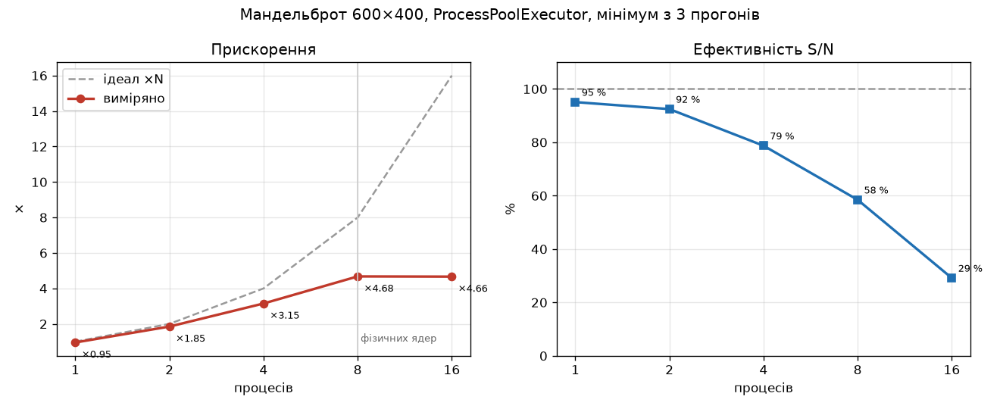

# Практична 04. Процеси

Код: `protsesy.py`, графік: `grafik.py` → `grafik.png`, сирий вивід: `vyvid.txt`, `vyvid-chunksize.txt`.

Ryzen 7 2700: **8 фізичних ядер, 16 логічних**. Windows 11, Python 3.12.
Мандельброт 600×400, max_iter=500, кожен рядок окреме завдання.
По 3 прогони, беру мінімум. `assert rezultat == base` пройшов у всіх прогонах.

## Результати

Послідовно: 10.952 c.

| Процесів | Прогін 1 | Прогін 2 | Прогін 3 | Мінімум | Прискорення | Ефективність |
|---|---|---|---|---|---|---|
| 1 | 11.521 c | 11.525 c | 11.688 c | 11.521 c | ×0.95 | 95 % |
| 2 | 6.034 c | 6.036 c | 5.924 c | 5.924 c | ×1.85 | 92 % |
| 4 | 3.800 c | 3.656 c | 3.478 c | 3.478 c | ×3.15 | 79 % |
| 8 | 2.613 c | 2.638 c | 2.342 c | 2.342 c | ×4.68 | 58 % |
| 16 | 2.348 c | 2.351 c | 2.597 c | 2.348 c | ×4.66 | 29 % |

## Звідки розрив

На 16 процесах ідеал був би 10.95 / 16 = 0.68 c, а вийшло 2.35 c. Розклав найшвидший прогін:

| Частина | Час |
|---|---|
| ідеальна робота (10.93 / 16) | 0.68 c |
| запис файлу (послідовна частина) | 0.02 c |
| запуск і закриття пулу | 0.60 c |
| робота довша за ідеал | 1.05 c |
| **разом** | **2.35 c** |

**1. Закон Амдала: 0.02 c.** Послідовна частина (запис PGM) займає 0.2 %, стеля за Амдалом ×15.5.
Отже Амдал пояснює майже нічого.

**2. Запуск процесів: 0.60 c.** На Windows кожен процес запускає новий Python і заново імпортує модуль.
Окремо порожній пул із 16 процесів стартує 1.03 c, із 2 процесів 0.41 c.
Замір `with ProcessPoolExecutor(N) as ex: pass` дає 0.001 c, але це обман: процеси стартують тільки при першому завданні.

**3. Залізо: 1.05 c.** Фізичних ядер 8. Якщо рахувати лише роботу без запуску, 8 процесів дали ×6.10, а 16 процесів ×6.32.
Тобто гіперпотоки додали лише 4 %. До ×8 на 8 ядрах теж не дотягує, бо коли навантажені всі ядра, частота падає нижче boost 4.1 ГГц.
Пересилання результатів майже нічого не коштує: на 1 процесі робота займає 11.07 c проти 10.93 c послідовно.

## ⭐ chunksize (16 процесів)

| chunksize | Шматків | Час |
|---|---|---|
| 1 | 400 | 2.32 c |
| 8 | 50 | 2.59 c |
| 50 | 8 | 3.93 c |
| 200 | 2 | 6.27 c |

Великий chunksize поганий, бо шматків менше, ніж процесів: при 200 працюють лише 2 процеси з 16, а при 50 працюють 8.
До того ж рядки через середину множини рахуються довше, і процес з важким шматком закінчує останнім.
Дуже малий chunksize поганий, коли завдання крихітні, бо тоді пересилання дорожче за саму роботу.
У мене рядок рахується ~27 мс, це набагато більше за пересилання, тому chunksize=1 тут найкращий.
