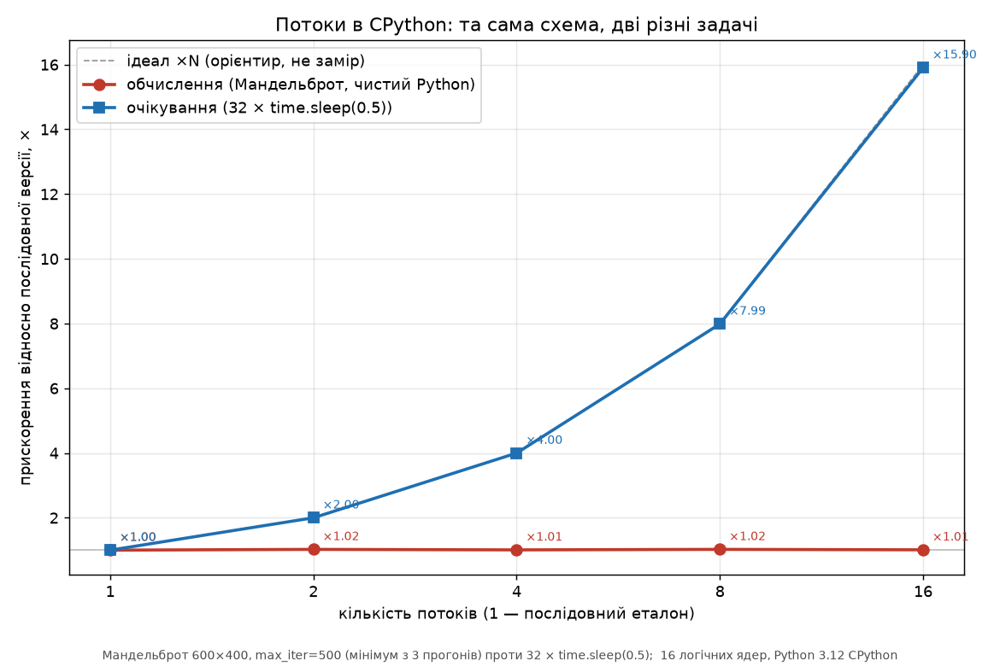
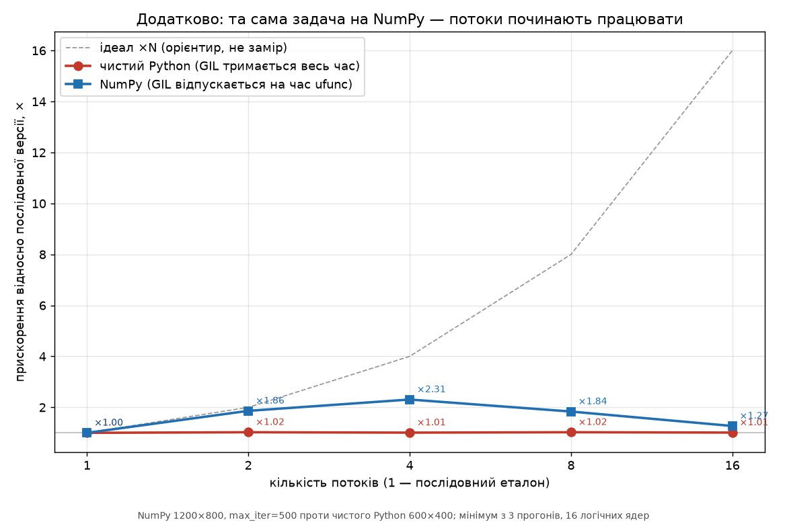

# Практична 03. Потоки і GIL

Код і заміри в папці [2-potoky](../../2-potoky):
`potoky.py` (Мандельброт), `ochikuvannya.py` (32 × `sleep(0.5)`),
`grafik.py` (графік), `numpy_potoky.py` (завдання із зірочкою).

Машина: Ryzen 7 2700 (8 ядер / 16 потоків), Windows 11, Python 3.12.
Мандельброт 600×400, max_iter=500. По 3 прогони, у таблиці мінімум.
`assert rezultat == base` пройшов у всіх прогонах.

## Результати

| Потоків | Обчислення, c | Прискорення | Очікування, c | Прискорення |
|---|---|---|---|---|
| 1 | 11.199 | ×1.00 | 16.010 | ×1.00 |
| 2 | 10.942 | ×1.02 | 8.007 | ×2.00 |
| 4 | 11.110 | ×1.01 | 4.004 | ×4.00 |
| 8 | 10.938 | ×1.02 | 2.004 | ×7.99 |
| 16 | 11.086 | ×1.01 | 1.007 | ×15.90 |

Усі три прогони лежать у `2-potoky/vyvid-obchyslennya.txt` і `vyvid-ochikuvannya.txt`.

## Чому криві різні

В обох версіях однаковий `ThreadPoolExecutor` і однакова кількість потоків, різниця лише в тому, що робить завдання.
Мандельброт на чистому Python весь час виконує байткод, а байткод у CPython одночасно може виконувати тільки один потік, який тримає GIL.
Тому потоки не рахують паралельно, а по черзі передають GIL один одному, і час лишається близько 11 с за будь-якої кількості потоків.
`time.sleep()` відпускає GIL на час паузи, тож поки один потік чекає, інші теж можуть почати чекати, і паузи йдуть одночасно.
Процесор під час очікування не потрібен, тому прискорення обмежене кількістю завдань, а не ядрами: з 32 потоками вийшло ×30, хоча ядер 8.
Отже, потоки в Python допомагають, коли програма чекає, і не допомагають, коли вона рахує, тому для Мандельброта потрібні процеси або NumPy/Numba.

## Скільки ядер працювало

Код і вивід: `2-potoky/navantazhennya.py`, `2-potoky/vyvid-navantazhennya.txt`.

`process_time()` ділю на `perf_counter()`, щоб побачити, скільки ядер було зайнято.
На Windows `process_time()` занижує (0.79 на послідовному прогоні, де працює одне ядро,
і 0.3–0.4 на потоках), бо `GetProcessTimes()` нараховує час за тиками таймера, а GIL
перемикається частіше. Для перевірки додав лічильник тактів процесу
(`QueryProcessCycleTime`), відкалібрований на послідовному прогоні (3.17 ГГц на ядро):

| Конфігурація | `process_time` / `perf_counter` | Ядер за тактами |
|---|---|---|
| обчислення, послідовно | 0.79 | 1 |
| обчислення, 2 потоки | 0.35 | 1.00 |
| обчислення, 8 потоків | 0.37 | 1.01 |
| обчислення, 16 потоків | 0.31 | 1.01 |
| очікування, 16 потоків | 0.00 | 0.00–0.01 |

Шістнадцять потоків на обчисленнях займають одне ядро: GIL пускає в інтерпретатор
по одному потоку. На очікуванні процесор майже не працює, тому потоки там не заважають один одному.

## Вартість пулу

Порожній пул потоків коштує 0.0002 c (2 потоки) … 0.0025 c (16 потоків).
Виграш на очікуванні з 16 потоками ≈ 15 c, тож пул забирає 0.017 % цього виграшу.

## Додатково: NumPy

Та сама схема, але смуга рядків рахується через NumPy, який відпускає GIL усередині ufunc. Розмір 1200×800, смуга 50 рядків.

| Потоків | Час, c | Прискорення |
|---|---|---|
| 1 | 2.750 | ×1.00 |
| 2 | 1.476 | ×1.86 |
| 4 | 1.192 | ×2.31 |
| 8 | 1.498 | ×1.84 |
| 16 | 2.168 | ×1.27 |

Тут потоки вже дають приріст, отже в чистому Python заважав саме GIL.
Після 4 потоків стає гірше. Схоже, що масиви перестають вміщатися в кеш, але це я не перевіряв.
З чистим Python результат розходиться у 8 точках із 240 000, усі на межі множини, через похибку округлення.
